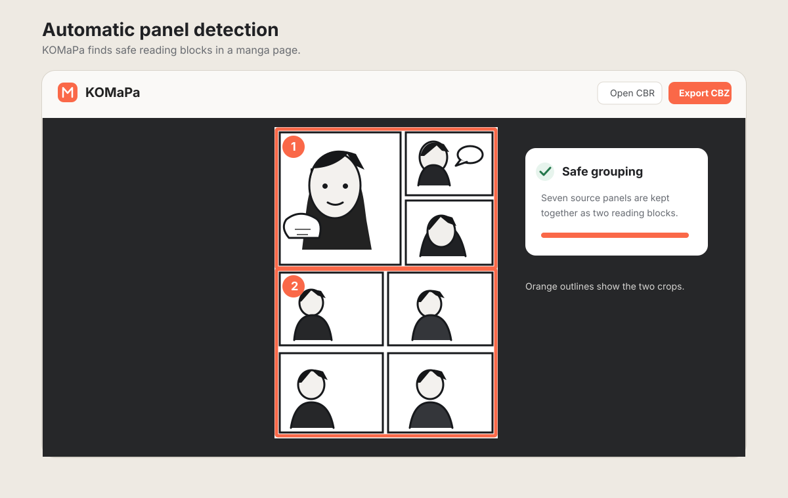
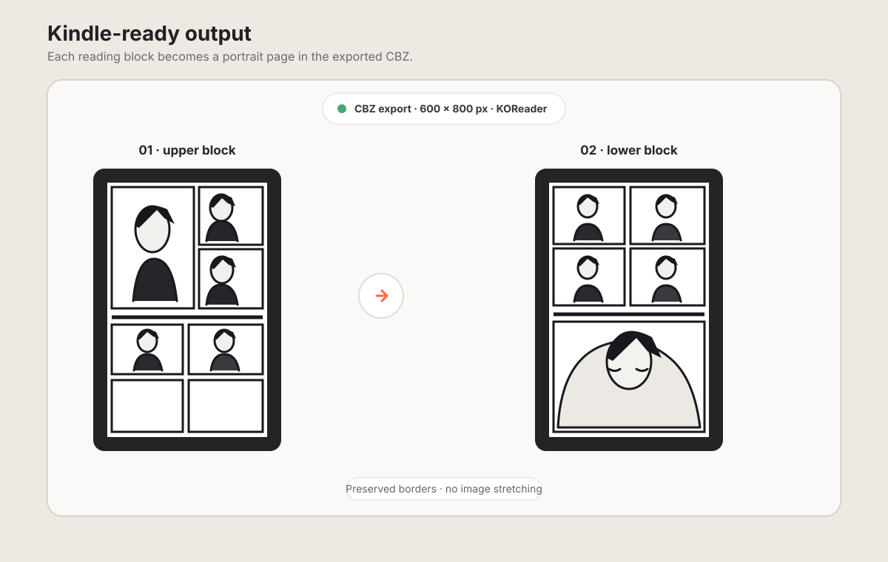

# KOMaPa

KOMaPa is a Windows desktop app that turns manga archives in **CBR or CBZ** format into a **Kindle 10 and KOReader friendly CBZ**.
It automatically detects manga panels and arranges them into up to **3 reading blocks per source page**.
Each block is fitted to a **600 × 800 pixel** page without stretching the artwork.
If a safe panel boundary cannot be found, KOMaPa tries to split the page into two blocks.
If that is still unsafe, it keeps the full page to avoid cutting through artwork or text.
Progress bars show the import, page processing, and export steps.

## Examples

These original illustrations show the app's intended workflow. They are **conceptual examples, not screenshots of the current interface**.

### Automatic panel detection

### Kindle-ready reading pages

## Requirements

- Windows 10 or 11
- Python 3.10 or later
- Pillow (`python -m pip install -r requirements.txt`)
- 7-Zip for CBR archives. CBZ archives do not require 7-Zip.

## Run KOMaPa

1. Extract this folder on your PC.
2. Open a terminal in the folder and run `python -m pip install -r requirements.txt`.
3. Start the app with `python app.py`.
4. Select **Abrir CBR / CBZ** (Open CBR / CBZ). KOMaPa analyzes the pages and displays detected boundaries and reading order.
5. Select **Exportar CBZ** (Export CBZ) and choose where to save the result.
6. Copy the resulting CBZ to your Kindle over USB, then open it from KOReader's file browser.

The numbered boxes show the detected reading order. Select **Volver a detectar** (Redetect) to run the analysis again if needed. Each source page produces no more than three reading blocks. If individual panels cannot be detected safely, KOMaPa looks for a clear, narrow boundary to split the page into two blocks. If it cannot find a safe split, it keeps the full page to avoid cutting content.

## Formats and detection notes

- CBZ archives are extracted directly.
- CBR archives require 7-Zip available in `PATH` or installed in its usual location.
- Automatic detection looks for clear gutters and dark divider lines. Crops overlap the detected gutter slightly to preserve the panel borders on both sides.
- Short title bands are avoided, and splits that would leave tiny fragments are rejected so words and lettering stay with their panel.
- A very short horizontal strip is automatically joined to its neighboring panel when they share nearly the full width. This avoids treating a small top or bottom band as a separate panel.
- Up to three small panels aligned in the same row can be grouped into one reading block. If a drawing appears to cross a detected boundary, KOMaPa tries to split the page into two blocks along a clear horizontal or vertical gutter; if none is safe, it keeps the full page.
- White strips inside the page margin are not treated as panel dividers, while small panels with clear black borders are preserved as independent panels.
- Each reading block is fitted inside a white 600 × 800 pixel page without distorting the image.
- KOMaPa does not modify or install firmware on the Kindle.

## License

KOMaPa is licensed under the GNU General Public License v3.0. See [LICENSE](LICENSE) for details.
